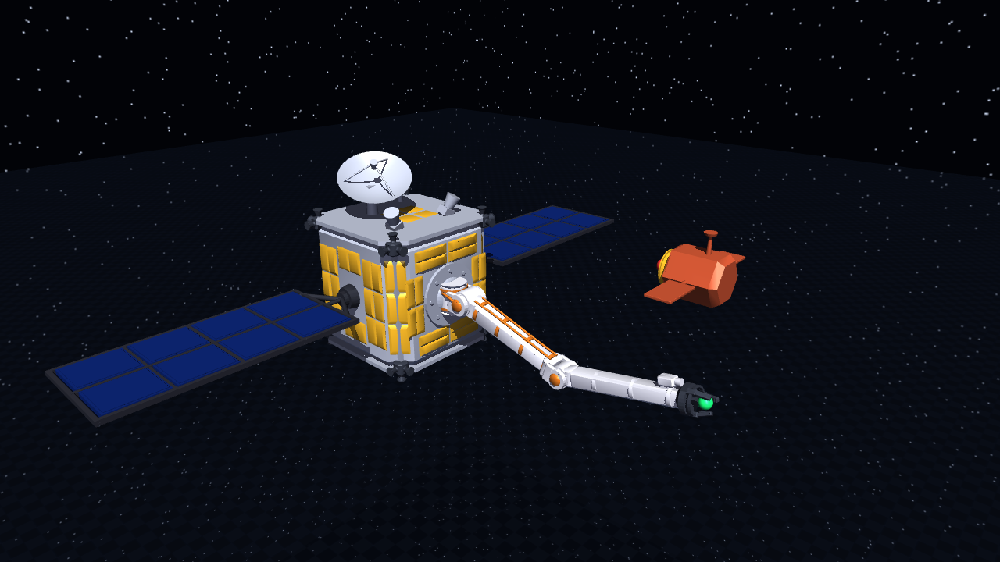
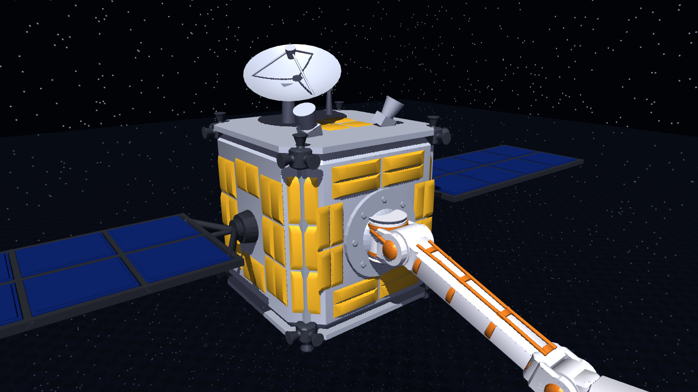
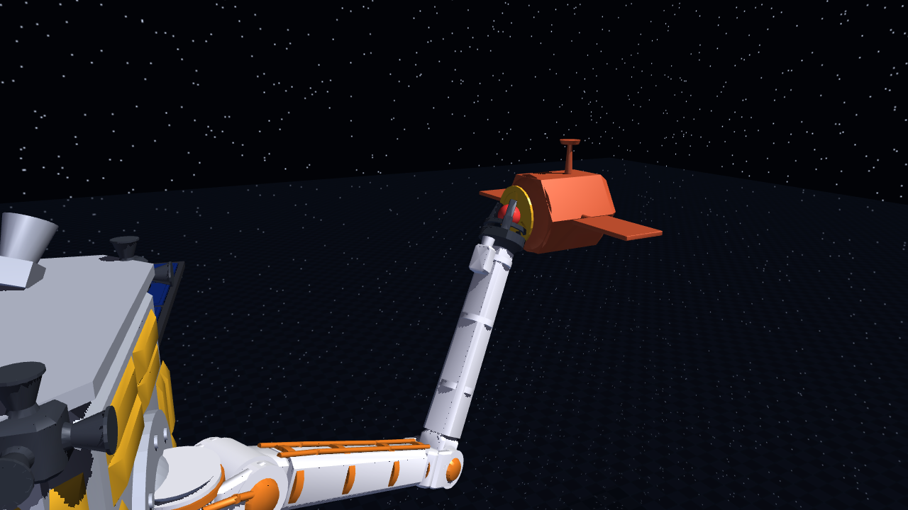
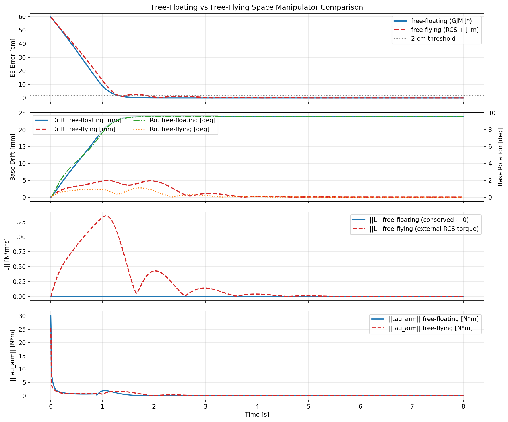

# MuJoCo Space Manipulator

*6-DoF Free-Floating & Free-Flying Orbital Robotic Manipulator Simulation in MuJoCo*

[](https://www.python.org/)
[](https://mujoco.org/)
[](#running-tests)
[](#license)

<p align="center">
  
</p>

---

## Visual Showcase

### 3D CAD Modeling in MuJoCo

| Spacecraft Bus & RCS Close-Up | Free-Floating Grapple Capture (`0g`) |
| :---: | :---: |
|  |  |
| *Octagonal bus, gold MLI thermal blankets, 24 de Laval RCS nozzles, star trackers, HGA parabolic dish, and 3-DoF arm shoulder.* | *3-finger end-effector converging on the target grapple fixture via Generalized Jacobian (GJM) while the spacecraft base reacts naturally in microgravity.* |

---

## Overview

**MuJoCo Space Manipulator** is a physics-accurate orbital robotics simulation built on **MuJoCo 3.x**, modeling a 6-DoF servicing spacecraft (45 kg octagonal bus with dual solar arrays and 24 RCS nozzles) equipped with a 3-DoF serial robotic arm (8 kg total across three links and a 3-finger gripper) capturing a target grapple fixture in zero-gravity (`0g`).

Unlike fixed-base terrestrial manipulators, moving a robotic arm in microgravity induces dynamic reaction forces and torques on the spacecraft bus. This repository implements, benchmarks, and visualizes the two canonical orbital control regimes:

- **Free-Floating Mode (`u_base = 0`):** Reaction thrusters and momentum wheels are off. The spacecraft base translates and rotates freely in reaction to arm motion while conserving total linear momentum (`P`), angular momentum (`L`), and system center of mass (COM). End-effector convergence is achieved via the **Generalized Jacobian Matrix (GJM, `J*`)**.
- **Free-Flying Mode (Active 6-DoF Base Control):** Base thrusters and attitude actuators (`base_fx..tz`) actively regulate position and quaternion attitude at `base_imu_site` while the manipulator tracks the target using the conventional manipulator Jacobian (`J_m`).

### Key Features

- **Zero-Gravity Orbital Physics:** Configured in `models/space_manipulator.xml` with `gravity="0 0 0"`, `timestep="0.002"` s (500 Hz), and 4th-order Runge-Kutta (`RK4`) integration.
- **Exact Dynamic Coupling & GJM Control:** Computes the full `9×9` mass matrix via `mj_fullM`, partitions base/arm blocks (`H_b`, `H_bm`, `H_m`), and solves the Generalized Jacobian `J* = J_m - J_b H_b⁻¹ H_bm` with Damped Least Squares (DLS) pseudoinversion and nonlinear `qfrc_bias` compensation.
- **6-DoF Quaternion Attitude Control:** Computes shortest-path body-frame axis-angle orientation errors directly from unit quaternions (`[w, x, y, z]`) for `free-flying` station-keeping.
- **Aerospace 3D CAD Assets & FreeCAD Workflow:** Includes 13 binary `.stl` meshes (modeled in millimeters, scaled `0.001` in MJCF) featuring gold MLI blankets, 24 de Laval RCS nozzles, SADA-mounted solar wings, a Canadarm2/SSRMS-inspired 3-DoF arm, and a target satellite with a grapple fixture—paired with a parametric FreeCAD macro and a standalone Python mesh generator.
- **Telemetry & Benchmarking Suite:** Interactive 3D MuJoCo passive viewer, headless CLI benchmark runner, Matplotlib single-mode and side-by-side comparison plots, and automated `pytest` verification.

---

## Mathematical Formulation

### 1. Coupled Spacecraft–Manipulator Dynamics

Consider the 9-DoF orbital system consisting of a 6-DoF floating base (`base_freejoint`) and a 3-DoF serial arm (`joint1`, `joint2`, `joint3`). In microgravity with zero external environmental disturbances, the coupled equations of motion are:

```math
\begin{bmatrix}
H_b & H_{bm} \\
H_{bm}^T & H_m
\end{bmatrix}
\begin{bmatrix}
\ddot{x}_b \\
\ddot{q}_m
\end{bmatrix}
+
\begin{bmatrix}
c_b \\
c_m
\end{bmatrix}
=
\begin{bmatrix}
F_b \\
\tau_m
\end{bmatrix}
```

where:
- `H_b` (6×6) is the base inertia matrix.
- `H_m` (3×3) is the manipulator inertia matrix.
- `H_bm` (6×3) is the dynamic coupling matrix between the spacecraft base and the arm.
- `ẋ_b = [v_bᵀ, ω_bᵀ]ᵀ` (6×1) and `q̇_m` (3×1) are the base twist and joint velocity vectors.
- `c_b` (6×1) and `c_m` (3×1) are the nonlinear Coriolis and centrifugal bias forces (`data.qfrc_bias` in MuJoCo).
- `F_b` (6×1) is the base control wrench (`base_fx..tz`) and `τ_m` (3×1) is the vector of arm joint torques (`act_joint1..3`).

### 2. Generalized Jacobian Matrix (GJM) — Free-Floating Mode

In **free-floating** operation (`F_b = 0`), no external forces or torques act on the spacecraft. Starting from rest with zero initial linear and angular momentum, total system momentum remains zero throughout the maneuver:

```math
H_b \dot{x}_b + H_{bm} \dot{q}_m = 0 \implies \dot{x}_b = -H_b^{-1} H_{bm} \dot{q}_m
```

Partitioning the inertial end-effector (`ee_site`) translational Jacobian into base (`J_b`, 3×6) and manipulator (`J_m`, 3×3) components yields:

```math
\dot{x}_{ee} = J_b \dot{x}_b + J_m \dot{q}_m = \left(J_m - J_b H_b^{-1} H_{bm}\right) \dot{q}_m = J^* \dot{q}_m
```

where `J*` (3×3) is the **Generalized Jacobian Matrix (GJM)**. In `space_manipulator.kinematics.compute_generalized_jacobian`, the coupling term `-H_b⁻¹ H_bm` is evaluated numerically via `np.linalg.solve(H_b, H_bm)` rather than explicit matrix inversion.

### 3. Task-Space DLS Control & 6-DoF Base Station-Keeping

Given target position `x_target` and current end-effector position `x_ee`, the desired task-space velocity is clamped to `max_ee_speed = 0.6` m/s (`kp_task = 4.0`):

```math
\dot{x}_{ee,\mathrm{des}} = \mathrm{clamp}\left(k_{p,\mathrm{task}} (x_{\mathrm{target}} - x_{ee}), \quad v_{\max}\right)
```

Desired joint velocities are computed via the **Damped Least Squares (DLS)** pseudoinverse (`λ = 0.04`) for singularity robustness, and mapped to joint torques with nonlinear bias compensation (`kv_joint = 14.0`, `kd_joint = 1.0`):

```math
J^{\dagger}_{\mathrm{DLS}} = J^T \left(J J^T + \lambda^2 I_3\right)^{-1}, \qquad
\dot{q}_{m,\mathrm{des}} = J^{\dagger}_{\mathrm{DLS}} \dot{x}_{ee,\mathrm{des}}, \qquad
\tau_m = k_v \left(\dot{q}_{m,\mathrm{des}} - \dot{q}_m\right) - k_d \dot{q}_m + c_m
```

- **Free-Floating (`mode="free-floating"`):** Uses `J = J*` and sets `F_b = 0`.
- **Free-Flying (`mode="free-flying"`):** Uses `J = J_m` and drives the 6-DoF base actuators at `base_imu_site` (clipped to `±50 N` and `±20 N·m`), with translation gains `kp_pos = 400.0`, `kd_pos = 180.0` and attitude gains `kp_att = 120.0`, `kd_att = 35.0`:

```math
F_{\mathrm{local}} = R_b^T \left(k_{p,\mathrm{pos}}(p_{\mathrm{ref}} - p_b) - k_{d,\mathrm{pos}} v_b + c_{b,\mathrm{lin}}\right)
```

```math
e_\theta = \mathrm{Log}\left(q_b^* \otimes q_{\mathrm{ref}}\right), \qquad
\tau_{\mathrm{local}} = k_{p,\mathrm{att}} e_\theta - k_{d,\mathrm{att}} \omega_b + c_{b,\mathrm{ang}}
```

---

## Benchmark Results: Free-Floating vs. Free-Flying

Results measured directly from the headless comparison benchmark (`duration = 8.00 s`, `target = (1.15, 0.35, 0.25) m`, initial arm configuration `q_m(0) = [0.0, 0.3, -0.5] rad`):

| Metric | Free-Floating (`GJM J*`) | Free-Flying (`RCS + J_m`) | Physical Meaning |
| :--- | :---: | :---: | :--- |
| **`final_ee_err`** | **`0.0000 cm`** | `0.0002 cm` | Final Euclidean distance between `ee_site` and `target_site`; both modes achieve sub-millimeter target capture. |
| **`base_drift` (final / max)** | `23.99 / 23.99 mm` | **`0.00 / 4.99 mm`** | Bus translation from origin; free-floating recoils as the arm extends, while RCS thrusters arrest drift in free-flying. |
| **`base_rot_final`** | `9.558 deg` | **`0.000 deg`** | Final attitude error relative to initial quaternion; GJM accounts for this `9.558°` base rotation during target tracking. |
| **`max_\|\|P\|\|`** | **`1.98e-08 kg·m/s`** | `1.62e+00 kg·m/s` | Peak total linear momentum of the spacecraft subtree (`base_sat` + arm); conserved at numerical zero without thrusters. |
| **`max_\|\|L\|\|`** | **`8.12e-10 N·m·s`** | `1.35e+00 N·m·s` | Peak total angular momentum about the system COM; conserved at numerical zero in free-floating, injected by RCS in free-flying. |
| **`com_drift`** | **`0.0000 mm`** | `32.1620 mm` | Maximum excursion of the combined spacecraft COM; invariant under purely internal joint torques. |

<p align="center">
  
</p>

---

## 3D CAD Architecture & FreeCAD Integration

Physics collision primitives in `models/space_manipulator.xml` are cleanly separated into MuJoCo `group="3"` (preserving exact mass, inertia tensors, and joint axes), while high-resolution visual CAD meshes (`group="0"`, `contype="0"`, `conaffinity="0"`) are loaded from 13 binary `.stl` files stored in **millimeters** with `scale="0.001 0.001 0.001"`:

| Component | STL Mesh (`models/meshes/`) | Triangles | Material | Description |
| :--- | :--- | :---: | :--- | :--- |
| **Servicing Bus** | `sat_bus_frame.stl` | 2,132 | `bus_alloy` | Octagonal chassis (`600 × 600 × 600 mm`), top HGA parabolic dish, dual star trackers, S-band mast, `+X` arm adapter |
| **Thermal Blankets** | `sat_mli_foil.stl` | 1,312 | `gold_mli` | Multi-Layer Insulation (MLI) crinkle-relief gold foil panels across bus faces |
| **RCS Propulsion** | `sat_rcs_thrusters.stl` | 7,232 | `rcs_dark` | 8 corner thruster pods with 3 conical de Laval nozzles each (**24 nozzles total**) |
| **Solar Wing Structure** | `solar_array_frame.stl` | 736 | `carbon_fiber` | Dual SADA rotary drums, Y-yoke deployment trusses, and ribbed perimeter frames along `±Y` |
| **Solar Photovoltaics** | `solar_array_cells.stl` | 576 | `solar_cell` | Raised stepped photovoltaic cell bays on `+Z` and `-Z` wing faces |
| **Arm Link 1 (Shoulder Yaw)** | `arm_link1_housing.stl` | 720 | `aero_white` | Joint 1 vertical actuator drum (`Z`-axis) and dual-cheek clevis yoke |
| **Arm Link 1 Accents** | `arm_link1_accents.stl` | 848 | `anodized_accent` | Thermal rings, Joint 2 encoder caps, and external umbilical conduit |
| **Arm Link 2 (Upper Boom)** | `arm_link2_housing.stl` | 592 | `aero_white` | Canadarm2/SSRMS-style tapered octagonal boom (`550 mm`) and Joint 3 clevis |
| **Arm Link 2 Accents** | `arm_link2_accents.stl` | 1,328 | `anodized_accent` | Joint encoder caps and dual shoulder cable harnesses |
| **Arm Link 3 (Forearm/Wrist)** | `arm_link3_wrist.stl` | 876 | `aero_white` | Tapered forearm boom (`510 mm`), reinforcing wrist rings, and optical inspection camera pod |
| **End-Effector Gripper** | `arm_gripper.stl` | 980 | `rcs_dark` | Wrist collar, capture alignment ring, and **3-finger** chamfered orbital gripper spanning `ee_site` |
| **Target Spacecraft** | `target_sat_body.stl` | 432 | `target_hull` | Hexagonal target bus with deployable solar fins and telemetry antenna (`mocap="true"`) |
| **Target Grapple Fixture** | `target_grapple_fixture.stl` | 556 | `gold_mli` | Conical capture alignment plate, grapple shaft, and 3 radial target tabs centered at `target_site` |

### Editing & Exporting Meshes in FreeCAD

1. Launch **FreeCAD**, open **Macro → Macros...**, select `models/meshes/freecad_space_manipulator.FCMacro`, and click **Execute** (uses the `Part` workbench).
2. The macro builds the full `SpaceManipulatorCAD` parametric assembly with all 13 solids positioned to match `models/space_manipulator.xml`.
3. Modify any dimension in the `PARAMS` dictionary (or edit the generated `Part` solids directly).
4. Re-export all 13 binary STL files (automatically transformed back into each body's local frame in millimeters) by running in the FreeCAD Python console:
   ```python
   export_all_stl()
   ```
   *(Alternatively, set `AUTO_EXPORT_STL = True` near the top of the macro before executing.)*

### Regenerating Default Meshes via Python

To regenerate all 13 binary `.stl` assets programmatically without opening FreeCAD:

```bash
python -m space_manipulator.mesh_generator
```

---

## Project Structure

```text
mujoco-space-manipulator/
├── docs/
│   └── images/                                # MuJoCo 3D renders and telemetry comparison plots
├── models/
│   ├── meshes/
│   │   ├── freecad_space_manipulator.FCMacro  # Parametric FreeCAD Part-workbench CAD macro
│   │   └── *.stl                              # 13 binary STL meshes in mm (scale="0.001")
│   └── space_manipulator.xml                  # MJCF model (0g, RK4, 6-DoF base + 3-DoF arm + mocap target)
├── src/
│   └── space_manipulator/
│       ├── __init__.py                        # Public package exports
│       ├── model_loader.py                    # MJCF loading, index resolution, state reset, sensor helpers
│       ├── mesh_generator.py                  # Standalone parametric binary STL generator
│       ├── kinematics.py                      # Quaternions, J_b/J_m, partitioned H, GJM (J*), momentum
│       ├── controller.py                      # Free-floating (GJM) & free-flying (6-DoF RCS + J_m) controllers
│       └── sim.py                             # Simulation loop, telemetry, Matplotlib plots, and CLI
├── tests/
│   ├── test_model_loader.py                   # MJCF integrity, momentum conservation, and STL mesh checks
│   ├── test_controller.py                     # Quaternion error, GJM identity, and closed-loop convergence
│   └── test_simulation.py                     # End-to-end simulation, plotting, and CLI tests
├── pyproject.toml
├── requirements.txt
└── README.md
```

---

## Quickstart

### 1. Installation

```bash
git clone <repository-url>
cd mujoco-space-manipulator

pip install -r requirements.txt
pip install --no-build-isolation --no-deps -e .
```

*(If you prefer not to install in editable mode, prepend `PYTHONPATH=src` when running `python -m space_manipulator.sim`.)*

### 2. Interactive 3D Viewer (MuJoCo)

Run the real-time 3D passive viewer in **free-floating** mode (default):

```bash
space-manipulator --mode free-floating --duration 8.0 --target 1.15 0.35 0.25
```

Run in **free-flying** mode with active 6-DoF base stabilization:

```bash
space-manipulator --mode free-flying --duration 8.0 --target 1.15 0.35 0.25
```

### 3. Headless Benchmark & Telemetry Plots

Execute both regimes headlessly, print summary metrics, and generate a 4-panel Matplotlib comparison figure (`--plot`):

```bash
space-manipulator --headless --mode compare --duration 8.0 --target 1.15 0.35 0.25 --plot outputs/compare.png
```

Example terminal output:

```text
[free-floating] duration=8.00s | final_ee_err=0.0000 cm | base_drift(final/max)=23.99/23.99 mm | base_rot_final=9.558 deg | max_||P||=1.98e-08 kg*m/s | max_||L||=8.12e-10 N*m*s | com_drift=0.0000 mm
[free-flying] duration=8.00s | final_ee_err=0.0002 cm | base_drift(final/max)=0.00/4.99 mm | base_rot_final=0.000 deg | max_||P||=1.62e+00 kg*m/s | max_||L||=1.35e+00 N*m*s | com_drift=32.1620 mm
Saved comparison plot: outputs/compare.png
```

To record telemetry for a single mode:

```bash
space-manipulator --headless --mode free-floating --duration 8.0 --plot outputs/free_floating.png
```

### 4. Running Tests

Run the full unit and integration test suite with `pytest`:

```bash
pytest
```

All 15 tests verify MJCF options, sensor/site indexing, momentum conservation, GJM numerical identity, quaternion shortest-path attitude error, closed-loop convergence, STL mesh loading, Matplotlib plotting, and headless CLI execution.

---

## License

This project is intended for educational and research use under the MIT License.
